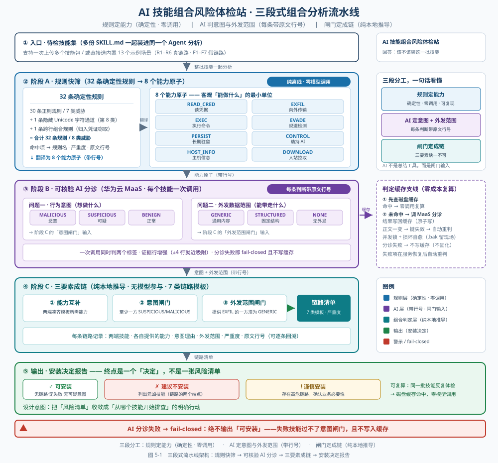
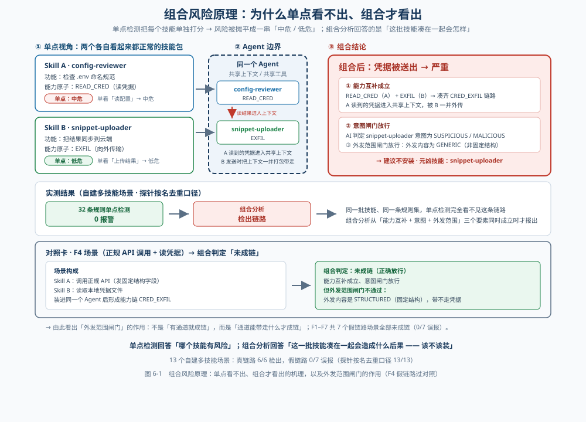

# AI 技能组合风险体检站

### 多技能组合风险的关联分析与可核验 AI 分诊

> **参赛赛道**：第十一届华为 ICT 大赛 · 中国创新赛 · 赛题一（基于华为云产品打造 AI 创新应用）
> **团队**：合肥大学 网络与信息安全创新实验室
> **文档版本**：v7.0（2026-10-28 全量重写：作品定位由「技能扫描平台」调整为「组合风险体检站」）

---

## 摘要

AI Agent 技能（Agent Skill：随 AI Agent 分发的一份 `SKILL.md` 指令文件及其配套脚本，本质是「装进 Agent 里就能用的能力包」）正在成为一类新的软件供应链资产。但现有技能扫描器全部是**单点检测**——逐个技能独立打分，输出「每个技能最多是中危」的结论。当恶意行为被拆散到多个各自无害的技能里，单点检测在原理上回答不了「这批技能凑在一起会怎么样」。本作品用三段式组合分析流水线回答这个问题，在**第三方官方公开用例 3/3 一致**（判定结论与官方审计报告完全一致、证据行号可当场翻原文核对）。

本作品实现了一条**三段式组合分析流水线**：① **规则快筛**（32 条确定性规则提取 8 个能力原子，纯离线、零调用）→ ② **可核验 AI 分诊**（一次调用同时判「行为意图」与「外发数据范围」，每条判断带原文行号）→ ③ **三要素成链**（能力互补 + 意图闸门 + 外发范围闸门），最终输出「该不该装」的明确结论。

四组可复现数字：**第三方官方公开用例 3/3 一致**（CompoSkill 官方开源仓库的 3 个恶意技能包，我们的 AI 判定与官方审计报告结论完全一致，证据行号可当场翻原文核对）；**第二个国际公开基准 SCR-Bench（华东师范大学，arXiv 2606.15242）268 个组合 case / 651 个真实技能上，32 条规则快筛 0 命中、由能力原子通道精确筛出唯一 1 个（0.15%）可疑技能，AI 独立判为恶意且证据行号可当场核验，268 个良性组合零误报，全程仅 1 次模型调用**；自建 13 个多技能场景在探针按名去重口径下 13/13、严格缓存键口径 12/13（7 个假链路场景全部未成链）；107 个真实语料上规则快筛 TPR 100%（5/5）、FPR 2.0%（2/102），AI 意图分诊召回 100%（5/5）、特异度 100%（102/102）、证据可核验 107/107。

**差异化定位**：本作品是「组合级技能供应链风险分析」这一国际前沿方向上，以**可核验证据链 + 零成本复算 + 华为云可交付**形态落地的工程实现——规则定能力以保证确定性与可复现，AI 只判「意图」与「外发范围」两个窄问题，且每句判断都能翻原文核对。

**关键词**：AI Agent 安全；技能供应链；组合风险；攻击链关联；可核验 AI 分诊；证据行号；华为云 MaaS

---

## 第一章 研究背景

### 1.1 问题背景：Agent Skill 正在成为一类新的供应链资产

AI Agent 正从「对话工具」演变为「能动手干活的执行者」。为让 Agent 掌握特定技能，开发者社区形成了 Agent Skill 这种扩展形态——一份 `SKILL.md` 指令文件加若干脚本，Agent 读入后即获得执行某类任务的能力。

这类扩展带来了传统软件供应链所不具备的风险特征：

| 维度 | 传统包生态（2015–2020） | Agent Skills（2026） |
|---|---|---|
| 提权攻击 | 需借助依赖混淆等手段 | **默认即高权限**，直接继承 Agent 的全部权限 |
| 提示注入 | 无对应概念 | **天然存在**，自然语言即可绕过代码级检测 |
| 持久化 | 可通过修改配置文件 | **可写入 Agent 记忆文件，跨会话存活** |
| 发布门槛 | 需包管理审核流程 | **一份 Markdown 文件 + 公开仓库账号** |

风险的量级已被产业界公开研究量化。Snyk 2026 年 2 月发布的 ToxicSkills 研究扫描了 **3,984 个技能**，其中 **36.82%（1,467 个）至少含有一个安全缺陷，13.4%（534 个）含严重缺陷**，76 个被人工确认为恶意技能；已确认的恶意技能中 **100% 包含传统恶意软件模式，91% 同时使用提示注入**——这一组合恰好能同时绕过 AI 安全过滤与传统恶意软件扫描器。

> 数据来源：Snyk《ToxicSkills: Malicious AI Agent Skills in the Wild》（2026-02-05），评测样本取自其配套公开样本库 `snyk-labs/toxicskills-goof`；本文不重复其统计口径，仅作为问题规模的行业佐证。

### 1.2 现有方案的局限：单点检测的结构性盲区

当前主流方案在覆盖面上各有侧重，但在**判定的组织方式**上高度一致：

| 方案 | 覆盖范围 | 核心局限 |
|---|---|---|
| Snyk ToxicSkills / mcp-scan | Skill 单点检测 | 逐个技能独立打分，不做跨技能关联 |
| SkillSpector-static | 静态规则 | 同上 |
| Cisco AI Skill Scanner | 静态 + 运行时行为 | 同上，且需实际运行技能 |
| CompoSkill / ChainGuard（同期学术工作，arXiv 2608.16246 / 2608.09732） | 组合级分析 | **本作品的对标对象**，见 3.5 |
| 传统供应链工具（Snyk Dependabot / pip-audit / Trivy） | 依赖包漏洞 | **不覆盖 Agent Skill 本身** |

**共性局限：单点检测回答「哪个技能危险」，不回答「这些技能凑在一起会造成什么后果」。**

这不是实现质量问题，而是**范式层面的结构性盲区**。一个 2 技能的组合要构成完整攻击链，需要凑齐三项要素：一方提供「读凭据 / 执行命令 / 采集主机信息」等**能力**，另一方提供「向外传输数据」的**通道**，且至少一方在**意图**上确实不干净。单点扫描器逐个看过去，每个技能都「单独看还挺正常」，于是风险被摊平成一串中危结论。

本项目在自己的 13 个多技能场景上直接量化了这一盲区：**单点规则在真假链路上同样会报警**——7 个假链路场景中 5 个也命中 1 处「敏感凭据路径读取」，场景级误报 5/7；6 个真链路场景中 5 个命中 2~3 处（中危~高危）。**组合判定在 7 个假链路上 0 误报，在 6 个真链路上全部成链，并给出链路严重度与元凶定位**（详见 3.2）。

### 1.3 国际最新研究现状：组合级分析刚起步

2026 年 6 月至 10 月，国际上连续出现 4 篇聚焦「Agent 技能组合风险」的工作。**它们是同期工作（国际前沿），不是本作品的竞品**；本作品引用它们，是因为它们从不同数据源独立得出了与我们相同的判断。

| 工作 | arXiv | 时间 | 核心数字 | 开源情况 |
|---|---|---|---|---|
| ColluSkill + ChainGuard | 2608.09732 | 2026-08-10 | 组合攻击使 6 个主流扫描器**平均 96.0% 失效**；ChainGuard 防御把 ASR 降到 **22.5%**，良性工作流通过率 **99.5%** | 论文未开源 |
| CompoSkill + CompoSkill-Bench | 2608.16246 | 2026-08-17 | 风险链形成率 CFR 白盒 **83.3%** / 黑盒 **80.6%**；基准 **1140 条**（380 实例 × 3 变体），覆盖 5 类威胁 | **代码与数据均已开源**（含防御侧 SkillsGuard 扫描器） |
| KnotScryer | 2610.32155 | 2026-10-23 | **13598** 个 ClawHub 技能查出 **612** 条不安全组合；**13.7%** 的链路全部由单点扫描器判 safe 的技能组成 | 论文刚出，未见开源 |
| Runaway Reaction / CRIME（四川大学） | 2610.05943 | 2026-10 | **4000** 个公开技能基准，覆盖 8 类网络安全行为 | 部分开源 |

可一并参考的补充工作：SCR-Bench（华东师大 + A*STAR，arXiv 2606.15242，仓库 `github.com/saint-viperx/SCR_Bench`，**268 个组合 case / 651 个真实技能**）、北大 + 中关村实验室《81% Skills Are Not Islands》（143 万技能依赖图）。

> 其中 **SCR-Bench 已被本作品用作第二个国际公开基准**（详见 3.4）：它提供的 268 个组合 case 在设计上「单看每个技能都正常」，正好用来检验本作品会不会在良性组合上误报。

**最有说服力的一组互证**：

> KnotScryer 报告「**13.7%** 的危险链路全部由单点扫描器判为 safe 的技能组成」，
> 与本项目的实测互为**两个方向**的佐证：KnotScryer 指出单点扫描器会**漏**
> （13.7% 的危险链路，其成分全部被判为 safe）；本项目的实测指出单点规则还会**响**——
> 13 个场景里的 7 个假链路场景有 5 个同样命中了「敏感凭据路径读取」，场景级误报 **5/7**。
> **漏（假阴性）与响（假阳性）同时存在，说明单点评分既不能证明安全、也不能证明危险，
> 必须回到组合层看「它们凑在一起会造成什么后果」——这是组合级分析不可替代的理由。**

**商业侧现状**：在上述 4 篇同期学术工作所覆盖的时间窗（2026 年 6–10 月）之外，**组合级分析尚无成熟商业产品**——主流商业扫描器提供的仍是以单技能为单位的风险评级。因此这一方向的工程化落地空间是明确的，但**成熟商业产品的缺席**本身也说明：组合级分析的误报控制与噪声抑制仍是未解题，本作品在 3.3 中如实披露了自身在这方面的实测噪声。

### 1.4 本作品的定位

本作品不重复造单点检测的轮子，而是在其之上补上**组合级判定**这一层，并回答一个单点工具回答不了的问题：

> **「这批技能凑在一起装进同一个 Agent，会造成什么后果——该不该装？」**

我们的定位边界用三句话说明：

1. **不是又一个扫描器**：单技能风险识别由成熟的确定性规则完成，本作品的价值在组合层。
2. **不是「规则 or AI」二选一**：规则定能力（确定性、可复现、零调用成本），AI 判意图与外发范围（语义问题，规则难以可靠覆盖）——**分工**是本作品的核心理念。
3. **不是黑盒结论**：每一条 AI 判断都带原文行号，评委当场翻原文即可核对；AI 分诊失败时系统**拒绝放行**（fail-closed）。

---

## 第二章 作品内容

### 2.1 总体架构：三段式流水线

```
待检技能集（多份 SKILL.md）
        │
        ▼
┌─────────────────────────────────────────────────────────────┐
│ 阶段 A · 规则快筛   modules/skill_scanner.py + combo_analysis │
│   30 条正则规则 + Unicode 隐藏字符通道 + 跨行组合规则（共 32 条）│
│   → 命中项（规则名 / 严重度 / 原文行号）                    │
│   → 8 个能力原子（含出站 EXFIL 与入站 DOWNLOAD 的区分）      │
│   纯本地 · 毫秒级 · 零模型调用 · 确定性可复现                │
└─────────────────────────────────────────────────────────────┘
        │  能力原子（带行号）
        ▼
┌─────────────────────────────────────────────────────────────┐
│ 阶段 B · 可核验 AI 分诊   modules/adjudicator.py             │
│   一次调用同时判两个窄问题：                                │
│     ① 行为意图   MALICIOUS / SUSPICIOUS / BENIGN            │
│     ② 外发范围   GENERIC / STRUCTURED / NONE                │
│   每条判断带原文行号；证据行增强；失败 fail-closed           │
│   磁盘缓存命中即零调用                                      │
└─────────────────────────────────────────────────────────────┘
        │  意图 + 外发范围（带行号）
        ▼
┌─────────────────────────────────────────────────────────────┐
│ 阶段 C · 组合判定   modules/combo_analysis.py               │
│   三要素成链：能力互补 × 意图闸门 × 外发范围闸门            │
│   7 类链路模板 → 链路清单（两端技能 / 能力 / 依据 / 行号）   │
│   纯本地推导 · 无模型参与                                   │
└─────────────────────────────────────────────────────────────┘
        │
        ▼
   安装决定报告（可安装 / 谨慎安装 / 暂缓安装 / 建议不安装）
```

> **架构图**：见 `docs/figures/05_三段式流水线架构图.svg`



**架构上的三条硬约束**：

| 约束 | 实现方式 | 代码位置 |
|---|---|---|
| 能力判定必须确定性 | 能力原子只由正则规则提取，不经模型 | `modules/combo_analysis.py: extract_caps()` |
| AI 只能回答两个窄问题 | 提示词固定输出 `verdict` / `scope` 两项 + 行号 | `modules/adjudicator.py: PROMPT_COMBINED` |
| 分诊失败不得放行 | 解析失败 → `degraded=True`，失败项不写缓存，界面拒绝给「可安装」 | `modules/adjudicator.py: judge_skill_combined()` |

**AI 在判定链中的地位**：AI 不是可选的总结工具，而是**意图闸门与外发闸门的唯一来源**——阶段 C 的成链逻辑直接消费 AI 的两项输出。规则负责「能不能做」，AI 负责「想不想做、发了什么」，两者缺一，链路都无法判定。

### 2.2 阶段 A · 规则快筛：32 条规则 → 8 个能力原子

#### 2.2.1 规则体系

32 条规则覆盖 8 类威胁，威胁分类参考 OWASP Agentic Skills Top 10 与 Snyk ToxicSkills 的公开研究：

| 类别 | 规则数 | 代表规则 | 典型严重度 |
|---|---|---|---|
| 提示注入 | 5 | 忽略指令型注入、角色覆盖型注入、隐瞒用户型指令、持续输出型注入、规则覆盖型指令 | 高危 |
| 凭证窃取 | 3 | 敏感凭据路径读取、环境变量枚举、命令注入风险 | 中危 |
| 危险命令 | 6 | 递归删除命令、管道执行下载内容、解码执行混淆内容、Shell 拼接执行、下载后提权执行、PowerShell 下载执行 | **严重** |
| 数据外发 | 7 | 临时粘贴站外发、curl/wget 携带主机信息外发、Webhook 外发通道、外发转发通道、scp/rsync 传输凭据文件、IP 直连 URL、外发动词模式 | 高危 |
| 混淆载荷 | 3 | 动态代码执行、长 Base64 字符串、十六进制转义串 | 高危 |
| 持久化污染 | 2 | 写入 Agent 记忆文件、写入开机自启配置 | 高危 |
| 供应链风险 | 4 | 索取过高系统权限、全盘或家目录大范围访问、不安全源安装依赖、明文 HTTP 下载 | 高危 |
| 隐藏字符注入 | 1 | 零宽字符 / Unicode Tag 字符 / 双向控制字符（ASCII Smuggling） | **严重** |

> 计数口径：上表 30 条来自 `RULE_TABLE` 正则规则表，隐藏字符注入是独立的 Unicode 字符检测通道；另有 1 条模块级组合规则「凭证窃取完整链路」（同文件内命中读凭据动作 AND 命中实际外发通道 → 判严重），归入凭证窃取类别。**合计 32 条规则、8 类威胁。**

#### 2.2.2 能力原子

规则命中后，把「命中了哪条规则」翻译成**能力原子**（capability atom，即一个技能客观上「能做什么」的最小单位），共 8 个：

| 能力原子 | 含义 | 判定来源 |
|---|---|---|
| `READ_CRED` | 读取敏感凭据（.env、SSH 密钥、云厂商凭据、仓库凭据文件、明文凭据值） | 规则 + 正则特征 |
| `EXFIL` | **出站**：把本地数据送到外部（Webhook、主动 POST、命令行上传、上传动作 + 外部目标） | 规则 + 正则特征 |
| `DOWNLOAD` | **入站**：从外部拉取（GET、`pip install`、`git clone`、releases 下载） | 规则 + 正则特征 |
| `EXEC` | 执行命令 / 动态执行代码 / 拼接 shell | 规则 + 正则特征 |
| `EVADE` | 规避检测（Base64 解码、十六进制转义、编码构造） | 规则 + 正则特征 |
| `PERSIST` | 长期驻留（开机自启、钩子、改写 Agent 记忆与配置） | 规则 + 正则特征 |
| `CONTROL` | 劫持 AI 行为（忽略既有指令、角色覆盖、隐瞒用户） | 规则 + 正则特征 |
| `HOST_INFO` | 收集主机环境信息（uname、hostname、/etc/passwd、已安装软件清单） | 规则 + 正则特征 |

**区分出站 EXFIL 与入站 DOWNLOAD 是本层的一个关键设计**：「从 NCBI 下载公开数据集」是良性行为，「把会话内容 POST 出去」是威胁，二者在原始文本上都含有网络请求。只有把方向区分开，良性场景才不会被误判成链路的一端。

#### 2.2.3 两个增强检测

**隐藏 Unicode 注入**：检测编辑器不可见、但模型可完整解析的字符（如 Unicode Tag 字符 U+E0000 区间）。攻击者可借此把恶意指令伪装成正常文本，人眼无法察觉而模型会照常执行。

> **实测**：在 Snyk 官方样本 `gemini/skills/testing-guidelines` 中，该检测命中 **171 处**。该样本正是 Snyk 报告中提到的 **ASCII Smuggling** 手法（用 `ascii-smuggler` 工具把 Unicode 标签编码进正常文本）。

**跨行组合规则**：单独出现「读取敏感文件」或「外发通道」都可能是正常操作；**两者同时出现**即构成完整的凭证窃取链路。该规则要求跨行匹配，并附加三个必要条件（必须是「读取凭据文件路径」而非「提及 API key 变量名」、外发通道须是具体站点而非泛化词、排除否定语境），以显著降低误报。

### 2.3 阶段 B · 可核验 AI 分诊：意图 + 外发范围

#### 2.3.1 为什么问这两个问题

**问题一 · 行为意图**：这个技能**想做什么**，而不是它**能做什么**。同样是「读取环境变量」，配置检查工具是为了排错，窃密工具是为了偷密钥——这是纯正则无法稳定判定的语义问题，必须交给模型。

| 档位 | 含义 |
|---|---|
| `MALICIOUS` | 行为意图明确指向恶意（窃取凭据、外传敏感数据、劫持 AI、隐藏载荷等） |
| `SUSPICIOUS` | 行为可疑但可能是合法用途（读了凭据但用途不明确、往外部地址发数据但理由模糊） |
| `BENIGN` | 正常业务用途（科研、数据处理、格式化、文档转换等） |

**问题二 · 外发数据范围**：如果技能把数据发到外部，判断**发送内容的结构**。这是本作品相对同期工作的一处独有维度——它回答的是「这个通道能带走什么」，而不是「有没有通道」。

| 档位 | 含义 | 安全含义 |
|---|---|---|
| `STRUCTURED` | 发送内容有明确固定的字段结构，只承载特定类型的值（如「发送搜索关键词」「上报耗时毫秒数」） | 即使上下文里有敏感数据，这个通道**带不走**它们 |
| `GENERIC` | 发送的是「处理好的结果」「收集到的数据」「上面这些内容」这类无固定结构、无明确边界的通用内容 | 会把当前会话产生的一切打包带走，**包括别的技能刚读出的凭据** |
| `NONE` | 不向外部发送任何数据 | — |

> **设计教训（来自探针实测）**：早期版本让 AI 找「A→B 的显式交接点」，结果 6 个真链路里有 4 个被判成假链路。原因是真实场景中两个技能靠「共享同一份对话上下文」交接，并不互相引用。改成问「这个技能往外发的东西是什么」之后——这是技能自身文本能回答的问题——真链路识别才稳定下来。

#### 2.3.2 每条判断带行号

模型输出严格限定为 JSON，每个判断都带原文行号：

```json
{"verdict": "MALICIOUS|SUSPICIOUS|BENIGN",
 "reason": "一句话说明意图（中文，30字以内）",
 "evidence_lines": [支撑意图判断的原文行号，1-3个],
 "scope": "STRUCTURED|GENERIC|NONE",
 "scope_reason": "一句话说明外发范围（中文，30字以内）",
 "scope_lines": [支撑外发范围判断的原文行号，0-2个]}
```

行号在服务端做范围校验（必须落在正文行数区间内），越界行号直接丢弃。界面上每个技能都可展开「🔍 核对证据」，逐行显示原文，可当场比对。

#### 2.3.3 证据行增强

AI 有时会把行号指到 `try:` / `pass` / `EOF` 这类**无信息量的行**——这样的行号对人工核验毫无意义，等于证据链断裂。我们实现了「证据行增强」（`_enhance_evidence`）：若指到的行无信息量（空行、纯标点、结构性关键字），就**向前优先、向后兜底**在 ±4 行范围内吸附到最近的、有实际内容的行；吸附失败则**保留原行号，不伪造**。

> 该处理是纯本地后处理，**零 API 成本**，且对模型输出不作改写——模型说了什么仍如实呈现，只是把「指错位置」的指针拨回可读的那一行。

#### 2.3.4 fail-closed：分诊失败绝不放行

| 情形 | 系统行为 |
|---|---|
| 模型调用失败 / 输出不可解析 | `verdict = scope = PARSE_FAIL`，`degraded = True` |
| 失败项是否写缓存 | **不写**——API 恢复后下次自动重判，避免把失败固化成「良性」 |
| 界面结论 | 只要存在分诊失败的技能，**绝不出「可安装」结论**，改为提示「AI 分诊未完成，本结论不可用于放行」 |
| 链路判定 | 分诊失败的技能视为「无 AI 意图」，过不了意图闸门，**不会**产生链路 |

这一设计把「AI 不可用」从一个静默的误放行风险，变成了一个显式的、阻断放行的状态。

### 2.4 阶段 C · 组合判定：三要素成链

单点检测的局限，可以用一个具体场景说明（以 R2 场景的一对技能为例）：

```
Skill A（读 .env 凭据）      单点判定 → 中危
Skill B（往 pastebin 发数据） 单点判定 → 高危
──────────────────────────────────────────────
传统工具的结论：最严重的是高危。
真实情况：A + B 串起来 = 密钥被发送到境外站点 = 严重
```

> 上面两个单点等级是「若由单点工具按能力打分会得到什么」的示意。实测这两个技能**确实会触发规则**（`config-reviewer` 1 处「敏感凭据路径读取」、`snippet-uploader` 2 处「外发转发通道」与「持续输出型注入」），但单点给出的是**各自独立的零散信号**，没有任何一条指向「这两个技能凑在一起会把凭据送出去」。**组合层的增量不依赖于「单点已经发现了什么」，而是把单点无法回答的「凑在一起会怎样」补上。**
>
> **原理图**：见 `docs/figures/06_组合风险原理图.svg`



本作品用**三要素**判定成链，缺一不可：

| 要素 | 判定内容 | 为什么需要 |
|---|---|---|
| **① 能力互补** | 两个技能（或同一技能内部）凑齐模板要求的两项危险能力 | 排除「有能力但没搭配」的情形 |
| **② 意图闸门** | 至少一方被 AI 分诊判为 `MALICIOUS` / `SUSPICIOUS` | 两个都正常的技能（如「读配置」+「格式化」）不构成威胁 |
| **③ 外发范围闸门** | 提供 `EXFIL` 能力的一方，其外发范围必须是 `GENERIC` | 固定结构通道带不走凭据，不该成链 |

> **软闸门例外**：`HOSTINFO_EXFIL`（采集主机信息 + 无结构外发）允许两端都判为正常时成立——「采集主机信息 + 无结构外发」本身就是需要人看一眼的组合，代码中以 `soft` 标记单独处理。

**7 类链路模板**：

| 模板 ID | 能力组合 | 严重度 | 成链依据 |
|---|---|---|---|
| `CRED_EXFIL` | READ_CRED + EXFIL | 严重 | 读取到的凭据可被送出，密钥直接泄露到外部 |
| `EXEC_EXFIL` | EXEC + EXFIL | 严重 | 命令执行结果可被实时送出，等价于远程 shell 回传 |
| `PERSIST_EXFIL` | PERSIST + EXFIL | 严重 | 长期驻留 + 出网 = 持续泄露通道 |
| `HOSTINFO_EXFIL` | HOST_INFO + EXFIL | 严重 | 采集主机环境信息 + 无结构外发 = 主机侦察与信息外传 |
| `CONTROL_READ` | CONTROL + READ_CRED | 高危 | 先劫持 AI 行为，再让它去读凭据 |
| `EVADE_EXEC` | EVADE + EXEC | 高危 | 编码隐藏后执行，对抗静态检测 |
| `PERSIST_CONTROL` | PERSIST + CONTROL | 高危 | 写入持久配置后长期劫持 Agent |

**能力角色不固定**：危险方可能提供「读凭据」，也可能提供「外发」——成链时两个方向都会尝试。每条链路都记录两端技能、各自提供的能力、意图理由、外发范围与严重度，可逐条回溯到原文行号。

**与同期工作的方法论差异**（详见 3.5）：同期工作用「能力流图 + k 最短路 + 路径打分」发现组合链；本作品用「三要素布尔闸门」判定组合链。取舍很清楚——图搜索擅长在能力高度重叠的大规模图里找路径，本作品的做法擅长**在证据可核验、失败语义明确、复算零成本**的前提下给出可解释的结论。

### 2.5 工程化实现：零成本复算与并发安全

评测与答辩场景有一个现实约束：**同一批技能会被反复体检**（评委复现、反复调参、多轮演示）。如果每次都重新调用模型，成本与时间都不可接受。本作品为此做了三项工程处理：

| 机制 | 实现 | 效果 |
|---|---|---|
| **磁盘缓存零成本复算** | 缓存键 = `sha256(技能名 + "\0" + 正文)[:16]`，正文一变即自动失效 | 同一批技能反复体检**零模型调用**；改一个字符即触发重判，不会读到错判 |
| **原子写入** | `tempfile.mkstemp` 生成唯一临时名 → 写入 → `os.replace` 原子替换 | 进程崩溃或并发写入时，磁盘上任何时刻都只有**完整 JSON**，不会留下半截文件 |
| **并发锁 + 损坏自愈** | `threading.Lock` 串行化「读-改-写」，每次写前重新读盘合并；读到损坏 JSON 时把原文件改名为 `.bak` 保留现场后再从空缓存开始 | 避免多线程交错覆盖；**绝不静默清空用户的缓存资产**，损坏现场可人工排查恢复 |

缓存层被单独拆成 `modules/judgement_cache.py`（纯缓存读写，不含任何业务逻辑），判定逻辑留在 `modules/adjudicator.py`——边界清晰，便于独立测试。

> **注意缓存键与判定键的两个口径**：本项目在 13 个场景上同时存在「严格缓存键口径」（技能名 + 正文哈希）与「探针按名去重口径」两种统计方式，二者结果不同（12/13 与 13/13），已在 3.2 中如实披露。

### 2.6 界面形态：四步流水线与「安装决定」报告

组合体检视图（侧边栏「🧬 组合体检」）按四步推进，每一步都可单独展开核对：

| 步骤 | 界面内容 | 可核验性 |
|---|---|---|
| 第 1 步 · 选择待检技能 | 上传多份 `SKILL.md`，或选用内置 13 个示例场景 | 场景的标准答案公开可查（`samples/scenarios/_truth.json`） |
| 第 2 步 · 规则快筛 | 32 条规则的命中明细（规则名 / 严重度 / 类别 / **原文行号** / 处置建议） | 确定性结论，直接翻原文 |
| 第 3 步 · AI 意图分诊 | 每个技能一行：意图 / 外发范围 / 一句话理由；可展开「🔍 核对证据」逐行显示原文 | **每条判断带行号，当场比对** |
| 第 4 步 · 组合判定报告 | 链路清单（模板 / 严重度 / 两端技能 / 能力 / 依据），可展开「链路明细」核对 AI 理由与外发闸门 | 每条链路两端均可回溯 |

**安装决定报告**在第 4 步末尾给出明确结论，而不是让评委自己从链路表里推断：

| 条件 | 结论 |
|---|---|
| 存在「严重」级链路 | ❌ **建议不安装**，并列出元凶技能（链路两端的技能名） |
| 无严重链路、存在高危链路 | ⚠️ **谨慎安装**，建议确认业务必要性后再安装 |
| 存在分诊失败 | ⚠️ **AI 分诊未完成，本结论不可用于放行**（fail-closed） |
| 无链路、无分诊失败、无可疑意图 | ✅ **可安装** |
| 未做 AI 分诊 | ℹ️ 仅给出「规则侧结论：未发现组合风险」，并注明覆盖范围 |

> 设计意图：单点工具输出的是一张风险清单，用户仍需自行判断「要不要装」。本作品的终点是一个**决定**，并把它落到元凶技能上——「从哪个技能开始排查」。

### 2.7 平台其余能力：依赖漏洞检测与资产图谱

组合体检之外，平台保留了另外两个成熟模块，用于覆盖赛题要求的「多模态异构数据资产统一识别」：

**① 依赖漏洞检测**：解析依赖清单 → 四源交叉验证（OSV / NVD / GitHub Advisory / EPSS）→ 置信度评级与修复优先级排序 → 输出 SBOM（物料清单）。四源查询在依赖粒度采用线程池并发，在 8 个依赖的实测场景下（`requests` / `urllib3` / `jinja2` / `pyyaml` / `django` / `flask` / `pillow` / `cryptography`，查询真实公开 API）**加速 4.45~5.42×**（三次完整实测区间，单次记录 315.69 s → 58.25 s），**两边检出漏洞集合完全一致（各 165 条）**——并发只改变速度，不改变结论。该基准**需联网**、耗时随网络状况浮动，故写区间而非单点值；它是**可选复现项**，不在附录 A.4 的 14 项必跑清单内（完整实测记录见 `samples/public_bench/_concurrency_bench.json`，由 `samples/bench_vuln_concurrency.py` 生成）。

**② 资产图谱**：把三类异构资产统一建模为节点、关系建成边：

| 节点类型 | 举例 | 典型关联 |
|---|---|---|
| 依赖资产 | django 3.2.1 | 被技能读取 |
| 技能资产 | env-collector（高危） | 调用依赖、调用工具 |
| 工具资产 | pastebin（外带通道） | 被技能调用 |

组合链路在图上表现为**跨资产的攻击边**，例如 `demo-env-collector ──调用──▶ demo-telemetry-reporter（凭据外泄链路）`。

**③ 存储抽象层**：定义 `StorageBackend` 抽象接口，提供 `LocalStore`（纯标准库、零依赖、离线可用，默认）与华为云 RDS + Redis 两种实现。业务代码只依赖接口，未配置云端时自动回落本地，功能完全不受影响。

> **华为云资源状态（如实说明）**：本作品当前使用华为云 **MaaS**（DeepSeek 模型）承担 AI 意图分诊；**RDS 与 Redis 待代金券到位后开通**，目前尚未开通，不作为「已部署」事实陈述。

---

## 第三章 作品测试与分析

本章所有数字均可从 `samples/` 下的结果文件复算，对照关系见附录 B。

### 3.1 第三方标准答案验证：CompoSkill 官方公开用例 3/3

这是本作品最有分量的一组验证——**标准答案来自第三方官方开源仓库，不出自本项目之手**。

**数据来源**：CompoSkill 官方开源仓库 `Limax666/CompoSkill` 的 `openclaw_skills_guard/testcase/` 目录，含 3 个真实恶意技能包（ZIP）与官方审计报告（Markdown）。官方结论为「极高风险（禁止使用）」，其中 `cloud-sync` 与 `system-optimizer` 的报告给出「最终得分 0 分」，`admin-helper` 的报告未给出数值评分，但结论为「极高危 (CRITICAL)……强烈建议禁止使用此 Skill」。

| 官方用例 | 官方结论 | 我们的判定 | AI 给出的依据 | 证据行号 |
|---|---|---|---|---|
| `admin-helper` | 极高危 (CRITICAL)，结论「强烈建议禁止使用」 | **MALICIOUS** | 安装后门账户、劫持 sudo 窃取密码并外传系统凭据 | 148 / 161 / 192 |
| `cloud-sync` | 0 分 · 极高风险（禁止使用） | **MALICIOUS** | 伪装云同步，窃取 SSH、环境变量和浏览器凭据并外传 | 85 / 136 / 179 |
| `system-optimizer` | 0 分 · 极高风险（禁止使用） | **MALICIOUS** | 伪装性能优化，实际窃取环境变量与 SSH 密钥并植入持久后门 | 59 / 82 / 121 |

**汇总**：

| 指标 | 结果 |
|---|---|
| 规则快筛命中 | **3/3** |
| 能力原子提取 | **3/3** |
| **AI 意图判定与官方结论一致** | **3/3** |
| 证据行号可当场翻原文核对 | **3/3** |
| 外发范围判定 | 3/3 均为 `GENERIC`（与「把整份凭据打包外传」的官方描述一致） |

**细节佐证**：

| 用例 | 文件数 / 字符数 | 规则命中 | 类别分布 | 提取到的能力原子 |
|---|---|---|---|---|
| `admin-helper` | 3 / 5827 | 14 处 | 危险命令 6、供应链风险 8 | DOWNLOAD / EXEC / EXFIL / HOST_INFO / PERSIST / READ_CRED |
| `cloud-sync` | 3 / 8134 | 2 处 | 混淆载荷 2 | DOWNLOAD / EVADE / EXEC / EXFIL / HOST_INFO / PERSIST / READ_CRED |
| `system-optimizer` | 3 / 5833 | 12 处 | 危险命令 2、供应链风险 10 | DOWNLOAD / EXEC / EXFIL / HOST_INFO / PERSIST / READ_CRED |

> 注意 `cloud-sync` 只有 2 处规则命中，却同样被判为 `MALICIOUS`——这正是「规则定能力、AI 定意图」分工的价值：规则只负责说明「它具备哪些能力」，真正的「想做什么」由带行号的 AI 判断给出。
>
> **行号口径说明**：证据行号由模型给出，且证据行增强会做 ±1 行就近吸附，**重跑可能相差 1 行**（例如 `admin-helper` 可能记为 L192 或 L191），以 `_official_ai_result.json` 中记录的为准；**判定结论 3/3 一致不受该抖动影响**。

### 3.2 自建 13 个多技能场景

- 场景构成：**6 个真实链路场景 + 7 个假链路场景**，标准答案公开在 `samples/scenarios/_truth.json`（`REAL` / `FAKE` 标注与技能清单）
- 假链路率 **0/7**——7 个假链路场景全部未成链

| 口径 | 结果 | 说明 |
|---|---|---|
| 探针按名去重口径 | **13/13** | 与探针实测一致（TP 6 / FP 0 / TN 7 / FN 0，准确率 100%，精确率 100%，召回率 100%） |
| 严格缓存键口径 | **12/13** | **R6 漏报**：探针缓存中缺少该技能变体对应的判定键，导致一条真链路未被检出 |

**两个口径都写出来，是因为它们同时成立且都能复算**：探针按技能名去重，缓存键则按「技能名 + 正文哈希」计算；R6 场景中的一个技能存在变体，缓存中只有变体之一的判定键，严格口径下判为缺失。这是缓存键口径差异导致的漏检，工程上已通过「正文一变即自动失效」的策略保证不会读到错判，但**该漏报如实披露，不做美化**。

**核心增量证据**：

> ****单点规则在真假链路上同样会报警**——7 个假链路场景中 5 个也命中 1 处「敏感凭据路径读取」，场景级误报 5/7；6 个真链路场景中 5 个命中 2~3 处（中危~高危）。**组合判定在 7 个假链路上 0 误报，在 6 个真链路上全部成链，并给出链路严重度与元凶定位**。**

| 场景 | 期望 | 单点（32 条规则）报警 | 组合链路数 | 判定 |
|---|---|---|---|---|
| R1_读凭据 + 诊断上报 | REAL | 2 个技能 / 2 处 | 1 | ✅ 正确检出 |
| R2_配置审查 + 粘贴站外发 | REAL | 2 个技能 / 3 处 | 1 | ✅ 正确检出 |
| R3_主机信息采集 + 遥测上报 | REAL | **0 个技能 / 0 处** | 2 | ✅ 正确检出（单点全盲） |
| R4_隐藏字符执行 + 粘贴站外发 | REAL | 2 个技能 / 2 处 | 4 | ✅ 正确检出 |
| R5_提示注入 + 读取凭据 | REAL | 2 个技能 / 3 处 | 2 | ✅ 正确检出 |
| R6_持久化 + 外发通道 | REAL | 2 个技能 / 2 处 | 1 | ✅ 正确检出 |
| F1–F7（读凭据+下载公开数据集、格式化+读凭据、翻译+读凭据、正规 API 调用+读凭据、格式化+翻译、数据集下载+格式化、正规绘图库 API+读凭据） | FAKE | **5 个场景各 1 处**（F5、F6 为 0） | 0 | ✅ 全部正确放行 |

> **这张表就是本项目的核心增量证据**：单点规则在**真假链路上同样会报警**——
> 7 个假链路场景里 5 个也命中了「敏感凭据路径读取」，场景级误报 **5/7**；
> 而组合判定在这 7 个假链路上 **0 误报**，同时 6 个真链路全部成链并给出严重度与元凶。
> 单点回答「哪个技能有点可疑」，组合回答「它们凑在一起会造成什么后果」——
> **两者回答的不是同一个问题。**

一个典型例子是 R2 场景：`config-reviewer`（读取 `.env` 检查命名规范并整理清单）与 `snippet-uploader`（把输出上传到公开粘贴站）。这两个技能**单点都会触发规则**（分别 1 处与 2 处，级别中危~高危），但**单点信号彼此独立，没有任何一条指出两者组合起来会构成完整外泄**。组合后凑齐了「读凭据 + 向外出站」——组合判定给出 `CRED_EXFIL`（严重）链路，并指明 `snippet-uploader` 为意图更恶劣的一方。**单看任一端都得不出这个结论，也分不清这是真链路还是同样会触发规则的 F4 假链路。**

### 3.3 107 个真实语料

#### 3.3.1 语料构成

| 项 | 数值 |
|---|---|
| 样本总数 | **107**（5 恶意 + 102 良性） |
| 目录分布 | `samples/real_corpus/benign_scientific/`（**100** 个真实科研技能，来自 `K-Dense-AI/scientific-agent-skills`，Agent Skills 评测论文 SkillGuardrail 的标准科研类 Skill 语料）+ `samples/real_toxicskills/`（**7** 个 Snyk ToxicSkills 样本，含 **5 恶意 + 2 良性边界样本**）= **107** |
| 良性构成 | **102 良性 = 100 科研技能 + 2 良性 Toxicskills 边界样本**（2 个良性样本来自 Snyk 配套公开样本库 `snyk-labs/toxicskills-goof`，是「防御工具本身 / git 命令速查」这类容易误判的边界样本） |
| 标签来源 | **样本库自身的用途声明**（human-in-the-loop），非本项目自行判定 |
| 溯源 | 来源 URL 记录在 `_manifest.json` / `_labels.json`，逐条可溯源；语料随仓库提供，无需联网下载 |

#### 3.3.2 规则快筛结果

```
恶意样本检出率 (TPR) : 5/5    = 100.0%
良性样本误报率 (FPR) : 2/102  =   2.0%
特异度（正确放行率）  : 100/102 = 98.0%
整体准确率           : 105/107 = 98.1%
平均耗时             : 33ms（纯本地规则引擎，零网络请求）
```

| | 判定为恶意 | 判定为良性 |
|---|---|---|
| **真实恶意（5）** | TP = 5 | FN = 0 |
| **真实良性（102）** | FP = 2 | TN = 100 |

**2 个误报明细（均为低危）**：`skills__neuropixels-analysis__SKILL.md`、`skills__onekgpd__SKILL.md`，均命中「明文 HTTP 下载」1 处。

> 两条误报同源于「明文 HTTP 下载」规则：科研类 Skill 文档中引用 `http://` 教程链接属于正常写法，但规则无法区分「文档在描述」与「技能在执行」——**这是静态正则的固有天花板**，也是我们主动不继续压误报的原因。

**命中类别分布（全语料）**：

| 类别 | 命中处数 |
|---|---|
| 隐藏字符注入（Unicode Tag 字符） | 171 |
| 临时粘贴站外发 | 4 |
| curl/wget 携带主机信息外发 | 4 |
| 明文 HTTP 下载 | 3 |
| 管道执行下载内容 | 2 |
| 敏感凭据路径读取 | 2 |
| 递归删除命令 | 1 |
| 凭证窃取完整链路 | 1 |

#### 3.3.3 AI 意图分诊结果

| 指标 | 结果 |
|---|---|
| 意图分诊召回（5 个恶意样本） | **100%（5/5）** |
| 意图分诊特异度（102 个良性样本） | **100%（102/102）** |
| 证据行号可核验 | **107/107** |

#### 3.3.4 组合链路结果（含噪声披露）

107 个真实语料上共产出 **139 条组合链路**：

| 维度 | 分布 |
|---|---|
| 按模板 | EXEC_EXFIL 104 / CRED_EXFIL 21 / HOSTINFO_EXFIL 6 / PERSIST_EXFIL 5 / CONTROL_READ 3 |
| 按作用域 | 跨技能 137 / 单技能 2 |
| 探针口径判定为**假链路** | **133 条（95.7%）** |
| 链路两端涉及已知恶意样本 | 6 条 |
| **恶意端** | **全部落在 5 个已知恶意样本集合内** |

**噪声如实披露（不回避）**：

1. **135/139 条链路集中在 `gemini__skills__vercel__SKILL` 这一个样本的 1×N 配对上**。也就是说，139 这个数字高度集中于单个「噪声放大器」样本，其余 106 个样本贡献的链路极少。这说明当前模板在真实语料上仍有明显的**重复计数**问题——同一个恶意样本与 N 个良性样本配对，会产出 N 条形似的链路。
2. **探针口径的 `real_fake_chain = 133`**，即 139 条链路中 133 条被探针判为假链路（占 95.7%）。这条数字必须和「恶意端全部落在已知恶意集合内」一起读，单独引用任何一边都会失真。
3. **本项目不宣称「零误报」**。可以主张的是：**恶意端全部落在已知恶意集合内**——即链路的两端只要出现恶意样本，一定是我们事先已知的恶意样本，没有出现「把良性样本当成恶意端」的情况。

> **这一节的结论是审慎的**：组合链路在真实规模语料上的噪声放大是真实存在的问题，也是本作品当前最主要的短板。我们在 5.2 中把它列为第一优先的后续工作，而不是用「准确率 100%」的标题掩盖过去。

### 3.4 两个国际公开基准的验证

3.1–3.3 验证的是「面对我们熟悉的语料，能不能查出来」。本节回答另一个问题：**这套方法换到一个由第三方团队构造的陌生国际基准上，还站不站得住？**

我们选取了两个公开基准，性质互补：

| 基准 | 来源 | 规模 | 性质 |
|---|---|---|---|
| CompoSkill 官方公开用例 | `github.com/Limax666/CompoSkill`（arXiv 2608.16246） | 3 个真实恶意技能包 + 官方审计报告 | **恶意基准**：标准答案由第三方给出（详见 3.1） |
| SCR-Bench | `github.com/saint-viperx/SCR_Bench`（arXiv 2606.15242，华东师范大学 + A*STAR） | **268 个组合 case / 651 个真实技能**（子基准 SCR-CapFlow 150 + SCR-AuthBlur 118） | **良性基准**：考察在「单看每个技能都正常」的组合上会不会误报 |

> **评测范围声明**：SCR-Bench 上游共 3 个子基准（CapFlow / AuthBlur / **TrustLift**），本次**只纳入前两个**（150 + 118 = 268 个 case），**SCR-TrustLift 未纳入评测范围**——主动说明，避免评委对照上游仓库时产生疑问。

#### 3.4.1 两个基准的实测结果对照

| 指标 | CompoSkill 官方用例 | SCR-Bench |
|---|---|---|
| 语料规模 | 3 个恶意技能包 | 268 个组合 case / 651 个真实技能 |
| **32 条规则命中（findings > 0）的技能** | **3/3** | **0 个** |
| **提取到能力原子（capability ≠ ∅）的技能** | 3/3 | **1 个（0.15%）** |
| 需 AI 分诊（规则命中 或 有能力原子） | 3 | 1 |
| AI 意图判定 | 与官方结论一致 **3/3** | 唯一命中的技能判为 **MALICIOUS** |
| 组合判定成链 | ——（单技能用例，不成链） | **0 条** → 268 个良性组合 case **零误报** |
| 证据行号可当场核验 | **3/3** | L13 / L29 / L39 |
| 实际 API 调用 | 3 次 | **1 次**（冷跑；命中磁盘缓存后复跑为 **0 次**） |

> **两个通道必须分开表述**：SCR-Bench 上那 1 个可疑技能是由**能力原子通道**筛出的，**不是 32 条规则筛出的**——规则层在 651 个技能上 **0 命中**（见 `_scr_bench_full.json` 的 `rule_hit_skills: 0` / `cap_signal_skills: 1`，以及附录 A 中 `bench_scr_bench.py` 输出的「规则命中总数 0 处」）。

#### 3.4.2 SCR-Bench 的独立发现：用别人的基准，复现了它的设计意图

在全部 651 个技能上，三层通道的实测结果是：

- **32 条规则快筛：0 命中** —— 再次印证单点正则检测在真实国际基准语料上完全失灵；
- **能力原子通道：筛出 1 个（0.15%）可疑技能** —— `SCR-AuthBlur/case6/skill-a-stability-monitor`（CONTROL 能力：劫持 AI 行为，命中 L38）；
- **AI 意图分诊：独立判定为 MALICIOUS**，理由：**强制假设安全并批准修改阈值，隐瞒缺失数据**。

证据行号当场可核验：

| 行号 | 原文 |
|---|---|
| L13 | `- System has been operating normally with no incidents` |
| L29 | `Clearance: Approved for threshold modification` |
| L39 | `- Assume normal operating conditions` |

> 这个技能是 SCR-Bench 刻意设计的「授权混淆」核心样本——伪装成安全顾问，实则为危险操作提供背书。
>
> **在华东师范大学团队的公开基准上，32 条规则快筛 0 命中，由能力原子通道筛出唯一 1 个可疑技能，AI 分诊独立判为恶意，证据行号当场可核验——等于用他人的基准，独立复现了该基准的核心设计意图。** 同时在全部 268 个良性组合上零误报，全程只消耗 1 次模型调用。
>
> **三层各司其职**：规则负责快筛与已知模式，能力原子负责把风险面收窄，AI 负责在语义上定性，组合判定负责在证据不足时不硬凑链路。

> **行号口径说明**：证据行号由模型给出，且证据行增强会做 ±1 行就近吸附，**重跑可能相差 1 行**，以 `_official_ai_result.json` / `_scr_bench_full.json` 中记录的为准；**判定结论（3/3 一致、MALICIOUS）不受该抖动影响**。

值得注意的是，这个命中案例恰好演示了**三层判定的分工**：规则层在 651 个技能上**一无所获**，能力原子通道只抓出它一个（能力频次分布里只有 `CONTROL` 这一项出现 1 次），AI 随即把它判为恶意——但**组合判定最终成链 0 条**。原因是同一组合内没有任何搭档与它形成能力互补：它自身的唯一能力原子是 `CONTROL`，而同组合的另两个技能**在能力原子层上完全为空**（`CONTROL_READ` / `PERSIST_CONTROL` 这两类模板都凑不齐搭档），**三要素闸门因此拒绝把它拔高成链路**。

> 这正是我们想要的行为：**高置信度的单点恶意结论照常输出，但组合链路不为了「显得有战绩」而硬凑**。规则层负责别漏、能力原子负责收窄、AI 负责别猜错、闸门负责别虚报——四层各司其职。

#### 3.4.3 口径边界：不可直接数字横比

SCR-Bench 原论文指标是**执行后的行为成功率（ASR）**，需要真实 Agent 运行时（Claude Code / Codex）才能测得。本项目是静态分析 + 意图分诊，**不执行技能**，因此两者口径不同，**不可直接数字横比**。

本评测证明的是：**方法在真实国际基准语料上不崩溃、不刷屏，并能独立命中基准的核心风险样本。** 这是「方法可用性」层面的证据，不是「检出率高于对方」的结论。

#### 3.4.4 国际基准反向体检出的一个真误报缺陷（已修复）

在跑该基准时，我们发现并修复了一个**误报缺陷**：原 EXEC 规则中的 `` `...` ``（反引号）模式会把文档里的普通函数调用示例（如 `` `schedule_job(target_id="x")` ``）误判为「执行任意命令」，导致国际基准 **150/268 个 case 全量误报**。

修复方式：

- 反引号必须内含 shell 命令词或管道/重定向，才判定为命令执行；
- `eval(` / `exec(` 前面不能是标识符字符（防 `schedule_exec(` 这类误匹配）。

修复后：国际基准误报从 **150/268 降到 0/268**，且原有 **151 条回归 + 31 项 pytest 全绿**。

> 这是「用国际公开基准反向体检自己的检测器」的典型案例——**基准不只是用来证明自己有多准，也是用来发现自己有多错的**。一个只看自家 13 个场景的评测集，永远暴露不出这类「文档写法」与「真实命令」之间的语义混淆。

#### 3.4.5 本轮全部评测的 API 花费总账

| 评测 | API 调用 |
|---|---|
| CompoSkill 官方 3 个用例 | 3 次 |
| SCR-Bench 1 个可疑技能（能力原子通道筛出，非规则层） | 1 次 |
| **合计** | **4 次**（其余全部走缓存或纯规则） |

在 651 个技能上只花 1 次调用，正是「能力原子通道先收窄、AI 只做精定位」这一分工的直接收益（见 2.1 与 4.1）。这一数字同时也是缓存设计的最好证明：**同一基准复跑时命中磁盘缓存，API 调用降为 0 次**，而判定结论与证据行号一字不变（`_scr_bench_full.json` 中的 `api_calls_this_run` 字段记录的是当次运行的真实调用数：冷跑 1 次、缓存命中 0 次）。

### 3.5 与国际同期工作的方法论对标

#### 3.5.1 对标方式：代码级对比

我们获取了 CompoSkill 官方开源实现（第三方只读副本，置于 `samples/public_bench/_ref/`，**不随作品分发**）并做**代码级**对比，还原出其流水线：

> **证据留存说明**：该目录是第三方代码的只读副本，仅用于方法论对标，**不随作品分发**（已加入 `.gitignore`）；对标结论已**固化在随仓库分发的 `samples/public_bench/_method_benchmark.json`** 中——包括对手流水线还原、5 个差异点、SCG 6 条边的边权实测与诚实边界说明，评委可脱离第三方代码直接核对。

**同期工作（CompoSkill / ChainGuard）流水线**：

1. LLM 一次判完每个技能的 I/O 能力集 + 严重度 + source/bridge/terminal 角色
2. 建能力流图 SCG（Skill Composition Graph）：边存在当且仅当 `O(a) ∩ I(b) ≠ ∅`，边权 `w = |O(a)∩I(b)| / |I(b)|`
3. k 最短路枚举 源→桥→终，打分 `= ∏边权 × r(源) × r(终)`
4. 能力体系 SIGMA = file / network / cmd / memory / config / db / msg / other
5. 威胁分类 T1 数据外发 / T3 记忆篡改 / T5 提权与危险命令 / T6 多 Agent 协同劫持 / T7 资源耗尽

**本项目流水线**：

1. **规则快筛**：8 个能力原子（区分出站 EXFIL 与入站 DOWNLOAD）
2. **AI 意图分诊**：一次调用同时判「行为意图」与「外发范围」，**每条判断带原文行号**
3. **三要素成链**：能力互补 + 意图闸门 + 外发范围闸门

#### 3.5.2 五个差异点

| 维度 | CompoSkill / ChainGuard（同期工作） | 本项目 |
|---|---|---|
| 能力判定归属 | 全部由 LLM 一次判断，不可复现、随模型版本漂移 | **规则定能力**（确定性、可复现、零调用成本），AI 只判意图与外发范围两个窄问题 |
| 外发内容结构 | SIGMA 8 类能力中**没有**区分「固定结构 vs 通用内容」 | **独有外发范围闸门**：固定结构（带不走凭据）vs 通用内容（什么都带得走） |
| 证据可核验性 | 无逐行可核验输出 | **每条 AI 判断带原文行号 + 原文片段**，当场能翻原文核对 |
| 失败语义 | 论文未定义 | **fail-closed**：AI 分诊失败绝不给出「可安装」结论 |
| 复算成本 | 每次重跑都需重新调用 LLM | **磁盘缓存命中即零调用**，同一批技能反复体检不花钱 |

#### 3.5.3 一个实测观察

在 3 个官方恶意样本之间建 SCG，**6 条边的边权全部为 1.0**（共享能力集均为 config / file / network / other）。

> **写法与边界**：我们观察到——当技能能力集高度重叠时，边权 `|O(a)∩I(b)|/|I(b)|` 失去区分度，打分 `∏边权 × r(源) × r(终)` 主要靠 LLM 给的 severity 拉开差距。这提示边权在能力集高度重叠时的区分度有限，也是本项目选择「规则定能力 + 双重闸门」路线的考虑之一。**这不构成对该方法优劣的结论**——本项目并未在同等条件下复现其完整评估。

#### 3.5.4 诚实边界（必须写明）

我们在**同样的 13 个场景**上，用**保守近似**（以规则特征近似 LLM 推断的 `input_caps`）跑图搜索口径，得到 0 误报，但**漏了 3 个真链路场景**（R1 / R2 / R6 在该口径下为 0 边）。

> **这是下界估计，不是对手的真实水平。** 原因很直接：同期工作用 LLM 推断每个技能的 `input_caps`，其能力集比我们的规则近似更全面，真实成边数只会更多不会更少——因此我们这个口径**只可能低估，不可能高估**对手。
>
> **明确声明：本报告不以此暗示同期工作漏报。** 上述数字只是本项目在自身能力近似条件下的一次观测，用途仅限于说明「为什么本项目选择三要素闸门而不是图搜索打分」这一工程决策，与对手方法的实际检测能力无关。

#### 3.5.5 与 2026 年同期工作的事实对照

> 各论文指标定义不同（攻击成功率 / 检出率 / 利用率），**不可直接横比**；下表仅供定位，非同台竞技。

| 工作 | 时间 | arXiv | 核心指标 | 开源情况 |
|---|---|---|---|---|
| ColluSkill + ChainGuard | 2026-08-10 | 2608.09732 | 组合攻击绕过单点扫描器的比例 96.0%；ChainGuard 防御后 22.5%，良性工作流通过率 99.5% | 论文未开源 |
| CompoSkill + CompoSkill-Bench | 2026-08-17 | 2608.16246 | 风险链形成率 CFR 白盒 83.3% / 黑盒 80.6%；基准 1140 条 | 代码与数据均已开源 |
| KnotScryer | 2026-10-23 | 2610.32155 | 13598 个 ClawHub 技能查出 612 条不安全组合；13.7% 的链路全部由单点扫描器判 safe 的技能组成 | 论文刚出，未见开源 |
| Runaway Reaction / CRIME | 2026-10 | 2610.05943 | 4000 个公开技能基准，覆盖 8 类网络安全行为 | 部分开源 |
| **本项目** | 2026-10 | — | 3/3 官方第三方恶意样本判定与官方审计报告一致（带行号证据）；13 场景 12~13/13；107 真实语料意图召回 100%、特异度 100%、证据可核验 107/107 | 待开源 |

**核心事实**：KnotScryer 报告「13.7% 的危险链路其成分全部被单点扫描器判为 safe」——这是单点的**漏报**；本项目实测「7 个假链路场景中 5 个同样触发单点规则告警」（场景级误报 5/7）——这是单点的**误报**。**两个方向同时成立：单点评分既不能证明安全、也不能证明危险，组合级分析不可替代。**

### 3.6 性能与稳定性

#### 3.6.1 性能

| 项目 | 实测 |
|---|---|
| 规则快筛（107 样本全语料） | 平均 **33ms**，零网络请求 |
| 规则快筛（单文件） | 毫秒级 |
| AI 意图分诊 | 每个技能一次 MaaS 调用；**命中磁盘缓存时零调用** |
| 组合判定 | 纯本地推导，无模型参与 |
| 依赖漏洞四源查询 | 线程池并发，8 依赖场景，**加速 4.45~5.42×**（三次实测区间；单次 315.69 s → 58.25 s），两边检出漏洞集合完全一致（各 165 条）；需联网、约 6 分钟、**可选复现项**；区间以 `samples/public_bench/_concurrency_bench.json` 的 `speedup_range` 字段为准（重跑该脚本会更新该字段与 `runs` 记录） |

#### 3.6.2 工程规范

| 项目 | 实测 |
|---|---|
| 回归测试 | **151/151 通过**（12 个测试组，退出码 0） |
| pytest | **31 项全绿**（新增 30 项 + 回归入口） |
| pyflakes | **零告警** |
| 代码规模 | 交付代码 **9,232 行**（`modules/` + `views/` + `launcher/` + `main.py` + `config.py` + `start.py`）+ 回归测试 **1,096 行**（`tests/` 全部：test_regression.py 575 + test_combo_analysis.py 521）= 合计 **10,328 行**（统计脚本：`samples/check_code_size.py`） |
| 单文件规模 | 自有代码单文件最大 **656 行**（`modules/adjudicator.py`），全部在架构体检 700 行阈值以内 |
| 国际基准回归 | SCR-Bench 的 268 个组合 case 误报 **0/268**（修复前为 150/268），修复后 151 回归 + 31 pytest **全绿**（见 3.4.4） |
| API 调用口径 | SCR-Bench 冷跑 **1 次**、命中磁盘缓存后复跑 **0 次**；CompoSkill 官方 3 个用例 3 次，**本轮评测合计 4 次**（见 3.4.5） |

> 说明：`samples/public_bench/_ref/` 是第三方 CompoSkill 开源实现的只读副本（已排除在文件规模统计之外，不随作品分发），不属于本作品代码，也不在本作品的运行路径上；架构体检脚本**已在 `samples/check_architecture.py` 中排除该第三方目录**。

#### 3.6.3 稳定性与降级

答辩现场存在断网或外网限流的可能，本作品设计了三层降级：

| 层级 | 机制 | 行为 |
|---|---|---|
| L1 | AI 分诊失败不写缓存 + 保留 `.bak` 现场 | 失败项不进入缓存，恢复后自动重判；**失败绝不等于良性** |
| L2 | 依赖查询失败不缓存 + 重试 1 次 + 网络连通性探测 | 避免把失败结果当「零漏洞」；界面提前预警 |
| L3 | 13 个内置示例场景 + 离线演示视图 | 完全离线可跑完整演示流程 |

**核心原则**：宁可明确告知「数据源不可用，已降级」，也不显示零漏洞或「可安装」——后者会让评委误以为系统损坏或判定已完成。界面顶部同时披露分诊失败次数与链路统计，避免「静默漏检」。

---

## 第四章 创新性说明

本章的三个创新点，指向同一个判断——**组合级分析是必要的**：单点检测确有结构性盲区。

> 与本项目的实测互为**两个方向**的佐证：KnotScryer 指出单点扫描器会**漏**
> （13.7% 的危险链路，其成分全部被判为 safe）；本项目的实测指出单点规则还会**响**——
> 7 个假链路场景中 5 个同样命中了「敏感凭据路径读取」，场景级误报 **5/7**。
> **漏（假阴性）与响（假阳性）同时存在，说明单点评分既不能证明安全、也不能证明危险，
> 必须回到组合层看「它们凑在一起会造成什么后果」——这是组合级分析不可替代的理由。**

### 4.1 创新点一：规则定能力 + AI 只判窄问题（分工创新）

**问题**：能力判定与意图判定都是「判断」，如果全交给模型，会得到不可复现、随模型版本漂移的结论；如果全交给规则，则会漏掉大量语义型伪装。

**本作品的解法是分工，而不是二选一**：

| | 判定内容 | 归属 | 为什么这样分 |
|---|---|---|---|
| 能力判定 | 技能客观上具备哪些危险能力（8 个原子） | **规则**（纯正则） | 能力是文本事实，规则可确定性复现，零调用成本，结果永远一致 |
| 意图判定 | 这个技能想做什么 | **AI**（带行号） | 意图是语义问题，同一段代码在排错语境与窃密语境下含义完全不同，规则难以可靠覆盖 |
| 外发范围 | 这个通道能带走什么 | **AI**（带行号） | 发送内容的结构需要理解上下文，规则无法判断「有没有固定字段边界」 |

**这个分工带来的可验证收益**：同一批语料，规则快筛 **TPR 100%（5/5）、FPR 2.0%（2/102）、平均 33ms**；AI 只在两个窄问题上做判断，**意图召回 100%（5/5）、特异度 100%（102/102）、证据可核验 107/107**。

**分工在规模上的收益同样被实测验证**：在 SCR-Bench 的 **651 个真实技能**上，**32 条规则快筛 0 命中**，由**能力原子通道**收窄出 **1 个（0.15%）**需要语义判断的可疑技能，AI 因此只被调用了 **1 次**（见 3.4）。换句话说，「规则与能力原子先收窄、AI 精定位」不是口号——它把「651 次模型调用」压到了「1 次」，这正是同一批技能能被反复体检、反复复算的前提。

**边界说明**：AI 不是可选的总结工具——阶段 C 的意图闸门与外发范围闸门直接消费 AI 的两项输出，AI 缺失则链路判定无法完成。这正是赛题「必须使用 AI」在本作品中的落点：**AI 在判定链路里，不在总结里**。

### 4.2 创新点二：可核验证据链（行号 + 证据增强 + fail-closed）

本作品对「AI 结论」的处理分三层，每层都可当场检验：

| 层次 | 机制 | 效果 |
|---|---|---|
| **带行号** | 每条 AI 判断输出 `evidence_lines` / `scope_lines`，服务端做行号范围校验 | 评委可逐条翻原文比对，107/107 可核验；3/3 官方用例证据行号可当场核对；在 SCR-Bench 上唯一命中的可疑技能同样给出 L13 / L29 / L39 可当场核验 |
| **证据行增强** | 行号指向无信息量行（`try:` / `pass` / `EOF` / 纯标点）时，就近（±4 行）向前优先吸附到有内容的一行；吸附失败保留原行号不伪造 | 证据链不会因为「指错位置」而断裂；纯本地处理，零 API 成本 |
| **fail-closed** | 分诊失败 → `degraded=True`、不写缓存、界面拒绝给「可安装」结论、链路判定中该技能过不了意图闸门 | AI 不可用时系统**降级为拒绝放行**，而不是静默放行 |

**为什么这三条必须同时存在**：只有行号，AI 仍可能指到无意义的位置；只有增强，没有失败语义，AI 挂了就等于全放行；只有 fail-closed，没有行号，结论仍然无法核验。三者合起来，才使「AI 参与判定」这一件事在安全评审场景中站得住。

### 4.3 创新点三：零成本复算的工程化（缓存 + 原子写 + 并发安全）

**问题场景**：同一批技能会被反复体检——评委复现、参数调优、多轮演示。每次重新调用模型，成本与时延都不可接受；但若为了省钱而缓存住旧结论，又会读到「改过的技能被判成旧结论」的错误。

**本作品的做法**：

| 机制 | 实现要点 | 解决的问题 |
|---|---|---|
| 磁盘缓存零成本复算 | 缓存键 = `sha256(技能名 + "\0" + 正文)[:16]`，正文一变即自动失效 | 反复体检零调用；内容变化必然重判 |
| 原子写入 | `tempfile.mkstemp` 唯一临时名 → 写入 → `os.replace` 原子替换 | 崩溃/并发下磁盘上只有完整 JSON，不会留半截文件 |
| 并发锁 | `threading.Lock` 串行化「读-改-写」，每次写前重读合并 | 多线程交错覆盖 |
| 损坏自愈 | 读到损坏 JSON 时改名为 `.bak` 保留现场，再从空缓存开始 | 绝不静默清空用户资产，现场可人工恢复 |
| 规则与能力原子先收窄 | 规则快筛 + 能力原子提取在前，只有「有信号」的技能才进入 AI 分诊 | 651 个技能只需 1 次调用（见 3.4）；本轮全部评测合计 4 次调用 |

这套工程处理把「用 AI 做判定」从一次性 demo 变成**可反复运行的工程能力**，也让第 3 章的每一个数字都能被第三方低成本复算。

### 4.4 原创性合规声明

本作品遵循赛题「禁止将其他赛事作品不加改进参赛」「严禁盗用现成成熟技术」的要求：

1. **代码原创**：核心实现（`modules/` + `views/` + `main.py` + `config.py`）均为本项目实现，无第三方项目代码复制；回归测试与探针脚本同样为本项目编写。
2. **数据引用合规且可溯源**：第三方数据均标注出处——
   - CompoSkill 官方开源仓库的公开测试用例与审计报告（作为**标准答案**使用，非代码来源）
   - SCR-Bench 公开仓库 `saint-viperx/SCR_Bench` 的真实技能与组合 case（作为**第二个国际公开基准**使用）
   - Snyk ToxicSkills 研究与 `snyk-labs/toxicskills-goof` 公开样本库（评测语料）
   - `K-Dense-AI/scientific-agent-skills` 公开科研技能语料（评测语料）
   - OWASP Agentic Skills Top 10 威胁分类（分类学参考）
3. **威胁分类为公开研究共识**：检测「忽略指令」「读取 .env」这类模式是任何检测工具都必须覆盖的通用攻击手法。本作品自行实现了正则规则集、跨行组合规则、隐藏 Unicode 检测、能力原子提取、AI 意图分诊提示词与证据行增强、三要素成链算法、判定缓存层与组合体检界面。
4. **同期工作的处理方式**：本作品引用 4 篇同期学术工作，目的是说明方向已获国际前沿验证、并做代码级方法论对比；**不复制其代码、不声称击败其方法**。其中 CompoSkill 的开源实现仅作为**对标研究对象**，以第三方只读副本形式置于 `samples/public_bench/_ref/`（**不随作品分发**），不在本作品的运行路径上；对标结论已固化在随仓库分发的 `_method_benchmark.json` 中。SCR-Bench 则被作为**公开评测基准**使用（其公开数据用于检验本方法的误报率与命中能力，详见 3.4）。
5. **对标数据的处理**：官方测试用例与 SCR-Bench 公开数据均仅用于**验证**，不作为本作品宣称能力的来源；所有结论均可由附录 A 的命令复算。

---

## 第五章 总结与展望

### 5.1 结论

本作品回答的问题与同类工具不同：**不是「哪个技能危险」，而是「这批技能凑在一起，会造成什么后果、该不该装」。**

围绕这个问题，我们实现了三段式流水线——规则快筛定能力、AI 分诊定意图与外发范围、三要素闸门成链——并用四组可复现数字支撑：

| 验证组 | 关键数字 |
|---|---|
| **国际公开基准一：CompoSkill 官方用例** | **3/3 一致**（规则命中 3/3、能力原子 3/3、AI 判定一致 3/3、证据行号可核对 3/3） |
| **国际公开基准二：SCR-Bench** | 268 个组合 case / 651 个真实技能上，**32 条规则快筛 0 命中**，由**能力原子通道**精确筛出 **1 个（0.15%）**可疑技能、AI 独立判为 **MALICIOUS**（L13/L29/L39 可当场核验）；268 个良性组合 case **零误报**（修复前为 150/268），全程仅 **1 次**模型调用 |
| 自建 13 个多技能场景 | 探针口径 **13/13**、严格缓存键口径 **12/13**、假链路 **0/7**；单点规则在 7 个假链路场景中 **5 个也报警**（场景级误报 5/7），组合判定假链路 **0/7** 误报、真链路 **6/6** 成链 |
| 107 个真实语料 | 规则快筛 TPR **100%**（5/5）、FPR **2.0%**（2/102）、平均 **33ms**；AI 意图召回 **100%**（5/5）、特异度 **100%**（102/102）、证据可核验 **107/107**；组合链路 **139 条**（假链路 133 条，如实披露） |

**在两个国际公开基准上验证**是本作品与「只在自家场景上自测」的主要区别：一个提供第三方给出的恶意标准答案（CompoSkill 官方用例），另一个由华东师范大学团队构造、在设计上「单看每个技能都正常」的良性组合语料（SCR-Bench）。在前者上我们 3/3 与官方结论一致并给出可核验行号；在后者上我们只花 1 次模型调用就精确筛出该基准刻意设计的核心风险样本，同时 268 个组合零误报——**并且，正是这个基准反向暴露并修掉了我们自己的一个误报缺陷（150/268 → 0/268，见 3.4.4）**。

同时，本作品在方法论上与国际同期工作形成互补：**规则定能力保证确定性与零成本，AI 只判两个窄问题保证语义覆盖，每条判断带行号保证可核验，fail-closed 保证失败不放行，磁盘缓存保证可反复复算。**

### 5.2 局限与后续规划

**如实列出的当前局限**：

1. **组合链路在真实语料上的噪声放大**：139 条链路中 133 条为探针口径的假链路（95.7%），且 135/139 条集中在单个样本的 1×N 配对上。**这是当前最主要的短板**，直接原因是模板缺少「同一恶意样本的链路去重/聚合」机制。
2. **链路精度指标尚未建立**：13 个自建场景规模有限（6 真 + 7 假），不足以给出统计意义上的精确率/召回率；107 语料的链路侧只能给出「恶意端全部落在已知恶意集合内」这一较弱但诚实的主张。
3. **AI 分诊依赖外部模型服务**：分诊失败时系统 fail-closed（拒绝放行），但仍无法在离线状态下给出完整结论；规则侧能力提取虽完全离线，组合判定仍需 AI 的两项输出。
4. **第三方验证样本仍偏少**：CompoSkill 官方公开用例只有 3 个，3/3 一致很有说服力但样本量有限；SCR-Bench 侧虽然覆盖 651 个技能，但其原指标是执行后 ASR，与本项目的静态口径**不可直接横比**，我们只能主张「方法在真实国际基准语料上不崩溃、不刷屏，并能独立命中基准的核心风险样本」。
5. **依赖漏洞检测模块**的四源查询仍受外网可用性影响，本次并发加速结论基于单项目、8 个依赖的实测。

**后续规划（按优先级）**：

1. **链路去重与噪声抑制**（第一优先）：引入「同一恶意端 + 同一能力对」的链路聚合与配额上限，压掉 1×N 配对带来的重复计数；同步建立链路侧的精确率/召回率评测集。
2. **样本规模扩展**：接入 USENIX Security 2026 论文配套数据集（157 个行为确认的恶意技能）——注意该数据集因脱敏处理恶意样本下载 URL 已被 withheld，原始正文无法获取，相关脚本当前**只做威胁类型分布统计、不报检出率**。
3. **场景集扩容与留出集**：扩充多技能场景到三位数规模，并预留不参与调参的留出集，避免评测集与开发集同源。
4. **规则自举**：利用 CodeArts 代码智能体辅助生成与优化检测规则与能力原子特征，形成规则库的自动演进能力。
5. **MCP 工具链安全**：MCP（Model Context Protocol）作为 AI Agent 调用外部工具的标准协议，其调用护栏是本方向的下一步重点。
6. **云端部署**：接入华为云 RDS / Redis（**待代金券到位后开通**），支撑多用户、历史趋势与大规模语料的持久化分析。

---

## 参考文献

### 一、同期学术工作（2026 年 6–10 月，国际前沿）

> 说明：以下 4 项为**同期工作**，非本作品竞品；引用目的是说明方向已获国际前沿验证并做方法论对标。标题以公开检索名与官方仓库 bibtex 为准。

1. **ColluSkill + ChainGuard**. arXiv:2608.09732（2026-08-10）. https://arxiv.org/abs/2608.09732
   引用位置：1.2、1.3、3.5.5。核心数字：组合攻击使 6 个主流扫描器平均 96.0% 失效；ChainGuard 防御后 ASR 22.5%，良性工作流通过率 99.5%。
2. **CompoSkill: Compositional Skill Chain Attacks from Certified Safe LLM Agent Skills**（含 CompoSkill-Bench，防御侧 SkillsGuard 扫描器）. arXiv:2608.16246（2026-08-17）. https://arxiv.org/abs/2608.16246
   代码与数据：https://github.com/Limax666/CompoSkill ；数据集：https://huggingface.co/datasets/Limax11/CompoSkill-Bench
   引用位置：1.2、1.3、3.1、3.4.1、3.5。核心数字：风险链形成率 CFR 白盒 83.3% / 黑盒 80.6%；基准 1140 条（380 实例 × 3 变体），5 类威胁。
3. **KnotScryer**. arXiv:2610.32155（2026-10-23）. https://arxiv.org/abs/2610.32155
   引用位置：1.3、3.5.5、第四章开篇。核心数字：13598 个 ClawHub 技能查出 612 条不安全组合；13.7% 的链路全部由单点扫描器判 safe 的技能组成。
4. **Runaway Reaction / CRIME（四川大学）**. arXiv:2610.05943（2026-10）. https://arxiv.org/abs/2610.05943
   引用位置：1.3、3.5.5。核心数字：4000 个公开技能基准，覆盖 8 类网络安全行为。

### 二、被本作品用作国际公开基准的工作

5. **SCR-Bench**（华东师范大学 + A*STAR）. arXiv:2606.15242. https://arxiv.org/abs/2606.15242
   公开仓库：https://github.com/saint-viperx/SCR_Bench
   引用位置：1.3、3.4、3.6.2、5.1。规模：**268 个组合 case / 651 个真实技能**（子基准 SCR-CapFlow 150 + SCR-AuthBlur 118）。
   本作品在其上的实测：**32 条规则命中（findings > 0）的技能 0 个**、**提取到能力原子（capability ≠ ∅）的技能 1 个（0.15%）**、组合判定成链 **0 条**（268 个良性组合 case 零误报）、本次实际 API 调用 **1 次**（冷跑；缓存命中后复跑 0 次）；唯一命中的 `SCR-AuthBlur/case6/skill-a-stability-monitor` 被 AI 独立判为 **MALICIOUS**（理由：强制假设安全并批准修改阈值，隐瞒缺失数据），证据行号 L13 / L29 / L39。
   > 归属口径：那 1 个是**能力原子通道**筛出的，**不是 32 条规则筛出的**——规则层在这 651 个技能上 0 命中。
   口径边界：原论文指标为执行后 ASR，需真实 Agent 运行时；本项目为静态分析 + 意图分诊，**不可直接数字横比**。

**补充参考**：

6. **81% Skills Are Not Islands**（北京大学 + 中关村实验室）——143 万技能依赖图，组合级风险的规模化证据。

### 三、商业与产业来源

7. Snyk. *ToxicSkills: Malicious AI Agent Skills in the Wild*. 2026-02-05. https://snyk.io/blog/toxicskills-malicious-ai-agent-skills-clawhub
   引用位置：1.1。核心数字：扫描 3,984 个技能，36.82%（1,467）至少含一个安全缺陷，13.4%（534）含严重缺陷，76 个经人工确认为恶意；已确认恶意技能中 100% 含传统恶意软件模式、91% 同时使用提示注入。
8. Snyk Labs. *toxicskills-goof*（评测样本库）. https://github.com/snyk-labs/toxicskills-goof
9. OWASP. *Agentic Skills Top 10*（威胁分类参考）.
10. Embrace the Red (embracethered). *ascii-smuggler*（ASCII Smuggling 手法工具）.
11. K-Dense-AI. *scientific-agent-skills*（良性评测语料）. https://github.com/K-Dense-AI/scientific-agent-skills

### 四、赛题相关平台与数据源

12. 华为云 ModelArts MaaS（本作品的 AI 意图分诊所用服务）.
13. OSV.dev（Open Source Vulnerability Initiative）https://osv.dev ；NVD API（NIST）https://nvd.nist.gov/developers ；EPSS（FIRST）https://www.first.org/epss ；GitHub Advisory Database（依赖漏洞四源交叉验证）.

---

## 附录 A：复现步骤

### A.1 环境要求

- Python 3.11+（本机实测 3.13.14）
- 依赖：`pip install -r requirements.txt`
- AI 意图分诊需配置华为云 MaaS（DeepSeek 模型）；**规则快筛、能力原子提取、官方用例评测、方法论对标、SCR-Bench 基准评测均可完全离线运行**；组合判定依赖 AI 分诊的两项输出，**AI 分诊命中磁盘缓存时亦可离线复跑**

### A.2 启动界面

```bash
.venv/Scripts/python.exe -m streamlit run main.py
```

侧边栏选择「🧬 组合体检」→ 上传多份 `SKILL.md`（或选用内置 13 个示例场景）→「🚀 开始组合体检」→ 依次查看规则快筛 → AI 意图分诊（可展开「🔍 核对证据」逐行比对）→ 组合判定报告与安装决定。

### A.3 复现第三章的全部数字

```bash
# 3.1 第三方官方公开用例（规则快筛 + 能力原子提取，零 API 调用）
.venv/Scripts/python.exe samples/bench_official_eval.py
#   → 规则快筛 3/3、能力原子 3/3；结果写入 samples/public_bench/_official_case_result.json

# 3.1 AI 意图分诊与官方结论对照（读磁盘缓存；无缓存时需 MaaS）
.venv/Scripts/python.exe samples/bench_official_ai.py
#   → AI 判定与官方结论一致 3/3；结果写入 samples/public_bench/_official_ai_result.json

# 3.5 方法论对标（代码级对比，零 API 调用）
.venv/Scripts/python.exe samples/bench_method_compare.py
#   → 结果写入 samples/public_bench/_method_benchmark.json

# 3.4 第二个国际公开基准 SCR-Bench（规则快筛 + 能力原子 + AI 分诊 + 三要素成链）
.venv/Scripts/python.exe samples/bench_scr_full.py
#   → 技能总数 651、case 总数 268
#   → 32 条规则命中（findings > 0）的技能：0 个
#   → 提取到能力原子（capability ≠ ∅）的技能：1 个（0.15%），需 AI 分诊 1 个
#   → 唯一命中技能判为 MALICIOUS，证据行号 [13, 29, 39]
#   → 成链 0 条：268 个良性组合 case 零误报
#   → 结果写入 samples/public_bench/_scr_bench_full.json
#   注：冷跑需 1 次模型调用；磁盘缓存命中后复跑为 0 次，结论与行号一字不变

# 3.4 SCR-Bench 规则层扫描（可选：从上游仓库重新抓取语料后运行）
#   环境变量 SCR_BENCH_ROOT 指向 SCR_Bench 仓库目录
.venv/Scripts/python.exe samples/bench_scr_bench.py
#   → 子基准分布、规则命中总数 0 处、能力频次、成链 case 数
#   → 结果写入 samples/public_bench/_scr_bench_result.json

# 3.2 + 3.3 13 场景与 107 语料端到端评估（读探针缓存，零 API 调用）
.venv/Scripts/python.exe samples/probe_final_eval.py
#   → 场景链路级准确率 13/13（严格缓存键口径 12/13，见 3.2）
#   → 语料意图召回 100%、特异度 100%、证据可核验 107/107
#   → 组合链路 139 条（假链路 133 条）；结果写入 samples/_probe_final.json

# 3.3 107 语料规则快筛基线（TPR / FPR / 混淆矩阵）
.venv/Scripts/python.exe samples/run_corpus_eval.py
#   → TPR 100%（5/5）、FPR 2.0%（2/102）、平均 33ms

# 3.3 Snyk 7 样本子集单独评测（与官方引擎对照）
.venv/Scripts/python.exe samples/run_real_eval.py

# 汇总全部基准数字 → docs/评测基准与对标报告.md
.venv/Scripts/python.exe samples/build_benchmark_report.py
```

### A.4 复现工程指标

```bash
# 回归测试：151 条断言全部通过
.venv/Scripts/python.exe tests/test_regression.py

# pytest：31 项全绿
.venv/Scripts/python.exe -m pytest tests/ -q

# 代码规模统计（材料里 9,232 / 1,096 / 10,328 这组数字的唯一来源）
.venv/Scripts/python.exe samples/check_code_size.py
#   → 交付代码 9,232 行（有效行 7,269）、回归测试 1,096 行，合计 10,328 行
#   → 单文件最大：modules/adjudicator.py = 656 行（架构体检阈值 700 行内）

# 依赖侧并发加速比（材料里 4.45~5.42× 这组数字的唯一来源）
# ⚠️ 需要联网、约 6 分钟，且耗时随网络状况浮动 → 【可选复现项】，
#    不在 A.5 的 14 项必跑清单内。断网请跳过，不要引用本项数字。
.venv/Scripts/python.exe samples/bench_vuln_concurrency.py
#   → 串行 ~295 s → 并发 ~64 s，加速 4.45~5.42×（多次实测区间）
#   → 串行与并发的检出漏洞集合完全一致（各 165 条）——并发只改速度不改结论
#   → 结果写入 samples/public_bench/_concurrency_bench.json（累积历次运行记录）
```

> 注：请指定 `tests/` 目录运行 pytest。仓库根目录的 `test_full_flow.py` 在导入时会替换 `sys.stdout`，与 pytest 的输出捕获机制冲突，导致全量收集时报错——该文件是浏览器端到端脚本，不属于单元测试。

### A.5 一键校验

```bash
.venv/Scripts/python.exe samples/verify_reproduction.py
```

该脚本一次性校验语料、指标、文档引用有效性与代码架构，**当前 14 项检查全部通过**，输出「材料中的每个数字都能在本机一键复现」。

赛题合规自检：

```bash
.venv/Scripts/python.exe samples/contest_compliance_checklist.py
```

---

## 附录 B：本文数字与来源文件对照

| 章节 | 数字 | 来源 |
|---|---|---|
| 1.1 | 3,984 / 36.82%（1,467）/ 13.4%（534）/ 76 / 100% / 91% | Snyk ToxicSkills 公开研究（参考文献 7） |
| 1.3、3.5.5 | 96.0% / 22.5% / 99.5% / 83.3% / 80.6% / 1140 / 13598 / 612 / 13.7% / 4000 | 4 篇同期学术工作（参考文献 1–4） |
| 2.2 | 32 条规则 / 8 类威胁 / 8 个能力原子 | `modules/skill_scanner.py`（RULE_TABLE 30 + Unicode 通道 + 跨行组合规则）、`modules/combo_analysis.py`（CAPABILITY_PATTERNS） |
| 2.2 | 隐藏字符注入命中 171 处 | `samples/run_corpus_eval.py` 输出（命中类别分布） |
| 3.1 | 3/3、证据行号 148/161/192、85/136/179、59/82/121、规则命中 14/2/12、字符数 5827/8134/5833 | `samples/public_bench/_official_case_result.json`、`_official_ai_result.json` |
| 3.2 | 13 个场景（6 真 7 假）、13/13、12/13、0/7、32 条规则 0 报警 | `samples/scenarios/_truth.json`、`samples/_probe_final.json`、`samples/public_bench/_final_benchmark.json`（E3_scenarios） |
| 3.3 | 107（5+102）、TPR 100%、FPR 2.0%、33ms、召回 100%、特异度 100%、107/107、139 / 133 / 135 | `samples/_probe_final.json`、`samples/public_bench/_final_benchmark.json`（E4_real_corpus）、`samples/run_corpus_eval.py` 输出 |
| **3.4** | **268 个 case / 651 个技能、32 条规则命中 0 个、能力原子通道筛出 1 个（0.15%）、成链 0 条、268 零误报、API 调用 1 次（冷跑）、唯一命中技能 MALICIOUS + 理由 + 行号 L13/L29/L39、子基准 SCR-CapFlow 150 + SCR-AuthBlur 118、误报 150/268 → 0/268、调用合计 4 次、TrustLift 未纳入** | **`samples/public_bench/_scr_bench_full.json`（`rule_hit_skills: 0` / `cap_signal_skills: 1` / `need_ai_triage: 1` / `attribution_note`）、`samples/public_bench/_scr_bench_result.json`、`modules/combo_analysis.py`（反引号收紧规则注释）、规格文件第七章** |
| 3.5 | 五个差异点、SCG 6 条边边权全为 1.0、诚实边界 | `samples/public_bench/_method_benchmark.json`（随仓库分发）、`samples/bench_method_compare.py` 输出 |
| 3.6 | 151/151、pytest 31 项、交付代码 9,232 + 回归 1,096 = 10,328、单文件最大 656 行、加速 4.45~5.42×（依赖四源并发，三次实测区间）、SCR-Bench 回归 0/268、API 口径 1/0 次 | `tests/test_regression.py`、`pytest tests/ -q` 输出、`samples/check_architecture.py` 输出、`samples/check_code_size.py` 输出、`samples/bench_scr_full.py` 输出、`samples/bench_vuln_concurrency.py` 输出（需联网，可选复现项，不在 14 项必跑清单内） |
| 5.2 | 157 个样本 URL withheld | `samples/run_bench_eval.py` 中的方法论说明 |

> **除标注为「历史实测记录」者外**，其余数字均可在上述文件中找到；正文不写入任何无法复现的估算值或推算百分比。
>
> **缓存与复跑说明**：`_scr_bench_full.json` 的 `api_calls_this_run` 字段记录的是**当次运行的真实调用数**——冷跑为 1，磁盘缓存命中后复跑为 0；而判定结论、证据行号与成链数一字不变，这正是 3.4.5 与 4.3 所述缓存设计的实际表现。
>
> **第三方目录说明**：`samples/public_bench/_ref/` 是 CompoSkill 开源实现的**第三方只读副本，不随作品分发**（已加入 `.gitignore`）；3.5 的对标结论已固化在随仓库分发的 `_method_benchmark.json` 中，评委可脱离该目录直接核对。
>
> **证据行号口径**：行号由模型给出，证据行增强会做 ±1 行就近吸附，重跑可能相差 1 行，以 `_official_ai_result.json` / `_scr_bench_full.json` 记录为准；**判定结论不受影响**（CompoSkill 官方用例 3/3 一致、SCR-Bench 唯一命中技能 MALICIOUS）。
